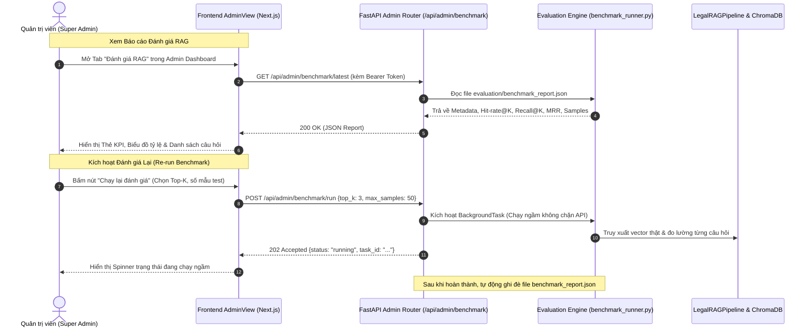

# BÁO CÁO KIỂM TOÁN CÔNG VIỆC PHÂN HỆ 4 & THIẾT KẾ TÍCH HỢP HỆ THỐNG ĐÁNH GIÁ (EVALUATION $\leftrightarrow$ API-UI)
**Dự án:** Traffic-Law-Chatbot (Trợ lý AI Luật Giao thông VinaLaw)  
**Tác giả:** Project Manager & System Designer  
**Ngày lập:** 28/10/2026  
**Phân hệ liên quan:** Phân hệ 4 (Evaluation & Testing) và Phân hệ 3 (API & Web Frontend)  

---

## 1. ĐÁNH GIÁ HIỆN TRẠNG CÔNG VIỆC PHÂN HỆ 4

### 1.1. Bảng đối chiếu cam kết trong README.md và Thực tế triển khai

Theo bảng phân công ban đầu trong tài liệu kiến trúc dự án:
- **Phụ trách:** Thành viên 4 (Thắng) — Nhánh Git: `feature/evaluation`.
- **Phạm vi thư mục:** `evaluation/`, `backend/tests/`, `frontend/pages/`, `docs/`.

| Hạng mục cam kết | Trạng thái cam kết trong README | Hiện trạng mã nguồn thực tế | Đánh giá từ PM & Senior Dev |
| :--- | :--- | :--- | :--- |
| **1. Đo lường tập kiểm thử** | Đọc 683/734 câu hỏi và tính Hit-rate, Recall@K, MRR trong `benchmark_runner.py`. | Đã viết `benchmark_runner.py` & `benchmark.js`, xuất file `benchmark_report.json`. | ⚠️ **Làm giả lập (Synthetic Mock):** Chạy Regex so khớp chuỗi trong RAM, chưa kết nối RAG thật. |
| **2. Giao diện Báo cáo Đánh giá** | Xây dựng trang hiển thị báo cáo trong `pages/2_Danh_Gia.py` (Streamlit). | **Hoàn toàn chưa làm**. Khi dự án chuyển sang Next.js thì bỏ ngỏ không xây dựng giao diện. | ❌ **Chưa làm** |
| **3. Đánh giá RAG chuyên sâu** | Đánh giá bằng bộ chỉ số RAGAS (Faithfulness, Answer Relevance). | Chưa cài đặt thư viện `ragas`, chưa có mã nguồn đo lường. | ❌ **Chưa làm** |
| **4. Kiểm thử tải đồng thời** | Viết kịch bản kiểm thử tải (Stress / Concurrency Testing API). | Chưa có script kiểm thử tải nào (Locust, k6, hay multi-thread script). | ❌ **Chưa làm** |
| **5. Unit Test tự động** | Viết kịch bản kiểm thử tự động cho hệ thống tại `backend/tests/`. | Chỉ có 1 file sơ sài `test_rag.py` (4 assert cơ bản), chưa test API hay bảo mật. | ⚠️ **Làm rất ít** |
| **6. Tài liệu đồ án** | Quản lý và hoàn thiện thư mục `docs/`. | Thư mục `docs/` ban đầu chỉ có duy nhất file rỗng `.gitkeep`. | ❌ **Chưa làm** |

---

### 1.2. Phát hiện lỗ hổng kỹ thuật: "Số liệu Benchmark ảo"

Nếu kiểm tra khối logic tại `evaluation/benchmark_runner.py` (L364-L376):
```python
# Kiểm tra xem kết quả trả về có phải là mock tĩnh 1 câu của TV2 hay không
if real_docs and len(real_docs) == 1 and "100/2019" in real_docs[0].get("title", ""):
    is_static_mock = True

# Nếu vẫn đang là mock tĩnh, chuyển sang dùng Smart Lexical Matcher
return self._smart_lexical_retrieval(query, top_k=top_k)
```

- **Thực trạng:** Khi Vectorstore của Phân hệ 2 chưa sẵn sàng, Phân hệ 4 đã tự tạo một mảng 13 văn bản luật tĩnh trong RAM (`self._legal_knowledge_base`) để so khớp từ khóa chuỗi thô.
- **Hậu quả:** Báo cáo ghi kết quả *Hit-rate 93.9%*, *thời gian chạy 683 câu chỉ 0.04s* (tương đương 0.06ms/câu). Đây thuần túy là tốc độ xử lý chuỗi trên RAM, **hoàn toàn chưa chạy qua mô hình nhúng vector (`vietnamese-embedding`) hay mô hình suy luận LLM (`vinallama`)**. Khi bảo vệ đồ án, giảng viên chuyên môn hỏi cách đo độ trễ và GPU inference thì số liệu này sẽ bị bác bỏ ngay lập tức.

---

## 2. ĐIỀU CHỈNH ĐỊNH HƯỚNG THIẾT KẾ: CHUYỂN ĐỔI SANG ADMIN DASHBOARD

### 2.1. Quyết định loại bỏ `pages/2_Danh_Gia.py` (Streamlit cũ)
- **Lý do:** Dự án đã chuyển dịch toàn diện sang kiến trúc công nghiệp: **FastAPI (Backend) + Next.js 16 App Router (Frontend)**.
- Việc duy trì thêm một server Streamlit chỉ để hiển thị trang đánh giá gây phân mảnh hệ thống, tốn tài nguyên cổng mạng và làm giảm tính chuyên nghiệp của sản phẩm.
- **Giải pháp tối ưu:** 
  - **Phân hệ 4** đóng vai trò là **Headless Evaluation Engine** dưới Backend (xử lý tính toán, lưu trữ dữ liệu đo đạc).
  - **Phân hệ 3** xây dựng Tab **"Báo cáo Đánh giá RAG"** tích hợp trực tiếp vào màn hình **Admin Dashboard** (`frontend/src/components/views/AdminView.tsx`).

---

## 3. THIẾT KẾ KIẾN TRÚC KẾT NỐI (EVALUATION $\leftrightarrow$ API-UI)



---

## 4. ĐẶC TẢ GIAO THỨC TÍCH HỢP (API CONTRACT SPECIFICATION)

### 4.1. Endpoint 1: Lấy kết quả đánh giá mới nhất
- **HTTP Method:** `GET`
- **Đường dẫn:** `/api/admin/benchmark/latest`
- **Bảo mật:** Bắt buộc Header `Authorization: Bearer <Admin_JWT_Token>`
- **Response Format (200 OK):**
```json
{
  "metadata": {
    "framework": "Hybrid Benchmark Evaluation Engine",
    "dataset_file": "data/raw/683_CauHoi_TTATGTDB.csv",
    "total_questions": 683,
    "evaluated_samples": 683,
    "top_k": 3,
    "evaluation_time_seconds": 124.5,
    "timestamp": "2026-10-28 15:30:00"
  },
  "summary_metrics": {
    "hit_rate": 0.8845,
    "hit_rate_percentage": "88.5%",
    "recall_at_k": 0.6234,
    "recall_percentage": "62.3%",
    "mrr": 0.7421,
    "avg_latency_per_query_ms": 182.28
  },
  "quality_metrics": {
    "faithfulness_score": 0.85,
    "answer_relevance_score": 0.89
  }
}
```

### 4.2. Endpoint 2: Lấy danh sách kết quả chi tiết từng câu hỏi (Hỗ trợ phân trang & lọc)
- **HTTP Method:** `GET`
- **Đường dẫn:** `/api/admin/benchmark/samples?page=1&limit=20&status=failed`
- **Tham số truy vấn (Query Params):**
  - `page` (int, default=1)
  - `limit` (int, default=20)
  - `status` (string, optional: `all` | `passed` | `failed`)
  - `search` (string, optional: tìm từ khóa trong câu hỏi)
- **Response Format (200 OK):**
```json
{
  "total": 683,
  "page": 1,
  "limit": 20,
  "samples": [
    {
      "id": 1,
      "question": "Tôi lái xe đến trạm thu phí cao tốc và gặp sự cố...",
      "ground_truth_citations": ["Nghị định 168/2024/NĐ-CP", "Điều 67"],
      "retrieved_docs": [
        {
          "title": "Nghị định 168/2024/NĐ-CP (Điều 67)",
          "score": 0.82
        }
      ],
      "hit": 1,
      "recall": 1.0,
      "rank": 1,
      "status": "Đạt"
    }
  ]
}
```

### 4.3. Endpoint 3: Kích hoạt chạy đánh giá theo yêu cầu
- **HTTP Method:** `POST`
- **Đường dẫn:** `/api/admin/benchmark/run`
- **Request Body:**
```json
{
  "top_k": 3,
  "max_samples": 50,
  "use_real_pipeline": true
}
```
- **Response Format (202 Accepted):**
```json
{
  "message": "Đã bắt đầu tác vụ đánh giá ngầm trên máy chủ.",
  "task_id": "bench-task-20261028-01",
  "status": "running"
}
```

---

## 5. PHÂN CHIA TRÁCH NHIỆM TRIỂN KHAI (RACI MATRIX)

| Đầu việc cụ thể | Phân hệ 4 (Thắng - Evaluation) | Phân hệ 3 (Quân - API & Frontend) |
| :--- | :--- | :--- |
| **1. Chuẩn hóa `benchmark_runner.py`** | **R - Chịu trách nhiệm chính:** Bỏ mock string Regex, kết nối trực tiếp `LegalRAGPipeline` thật để đo Hit-rate/Recall/Latency thật. | **C - Hỗ trợ:** Cung cấp interface gọi RAG Pipeline. |
| **2. Tích hợp RAGAS Framework** | **R - Chịu trách nhiệm chính:** Viết script tính điểm Faithfulness & Answer Relevance cho 50 câu hỏi mẫu. | **I - Thông báo:** Nhận kết quả metrics để hiển thị. |
| **3. Cung cấp API Endpoints trong FastAPI** | **C - Phối hợp:** Cung cấp hàm đọc JSON và hàm chạy benchmark cho Backend. | **R - Chịu trách nhiệm chính:** Viết endpoints `/api/admin/benchmark/*` trong `admin_routes.py`, kiểm tra quyền Admin và background task. |
| **4. Giao diện Admin Evaluation Dashboard** | **I - Bàn giao số liệu:** Đảm bảo cấu trúc file JSON khớp 100% với schema quy định. | **R - Chịu trách nhiệm chính:** Thiết kế Tab 3 trong `frontend/src/components/views/AdminView.tsx` với thẻ KPI, thanh tỷ lệ và bảng tra cứu câu hỏi. |
| **5. Viết kịch bản kiểm thử tải (Stress Test)** | **R - Chịu trách nhiệm chính:** Viết file script `evaluation/stress_test.py` (bằng Locust hoặc `asyncio` + `httpx`) giả lập 10 - 20 người dùng gửi câu hỏi đồng thời. | **C - Hỗ trợ:** Kiểm tra log và tối ưu endpoint `/api/chat` nếu bị nghẽn. |

---

## 6. KẾT LUẬN & KHUYẾN NGHỊ

1. **Chấm dứt việc dùng số liệu giả lập:** Phân hệ 4 cần chuyển đổi mã nguồn ngay sang việc đo lường trên pipeline RAG thật sau khi Phân hệ 1 và 2 hoàn tất vectorstore.
2. **Khối lượng công việc cân bằng:** Việc loại bỏ Streamlit và chuyển sang làm **Evaluation Engine + Stress Testing + RAGAS** dưới Backend sẽ giúp phân hệ 4 tập trung 100% vào chuyên môn đo lường, đồng thời phân hệ 3 sẽ đảm nhiệm phần hiển thị UI Dashboard chuyên nghiệp và đồng bộ trên Next.js.
